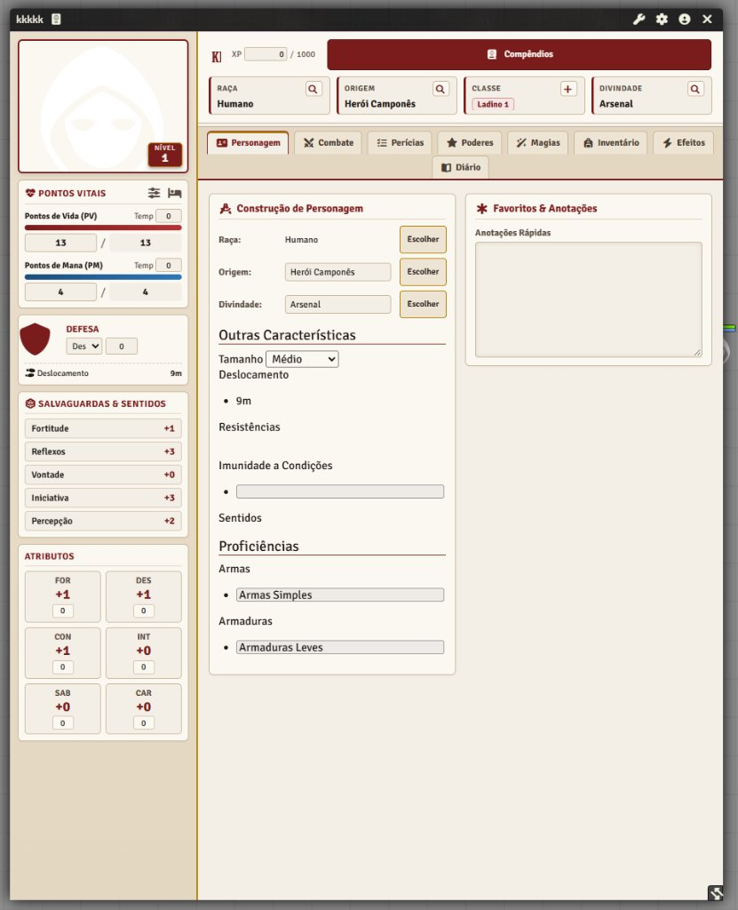
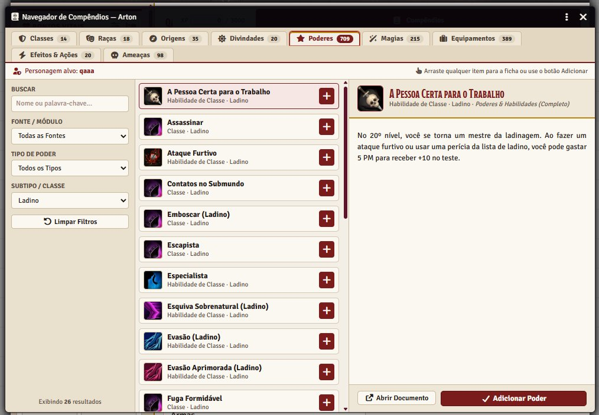
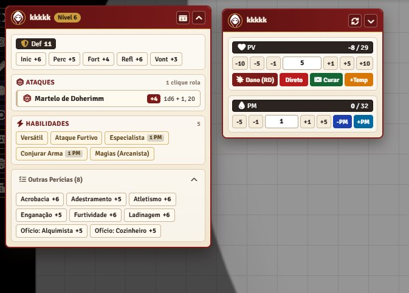
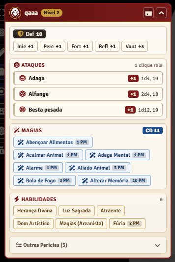
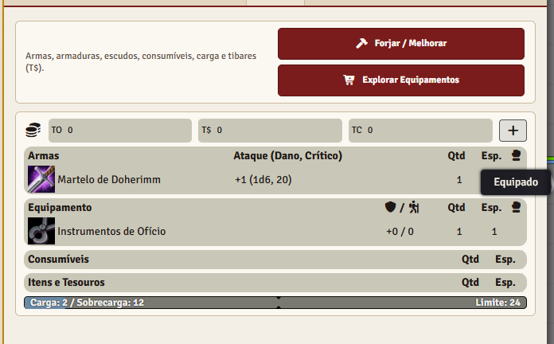
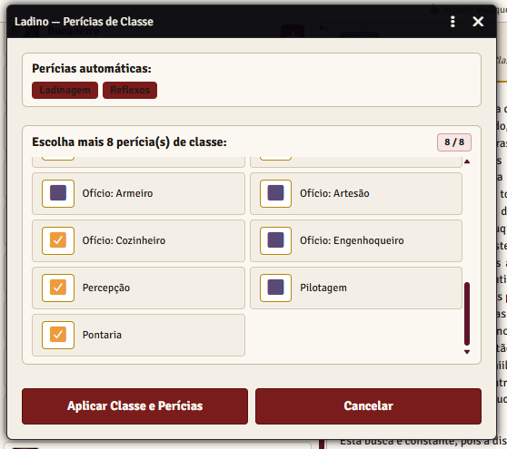
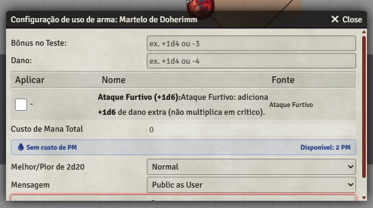
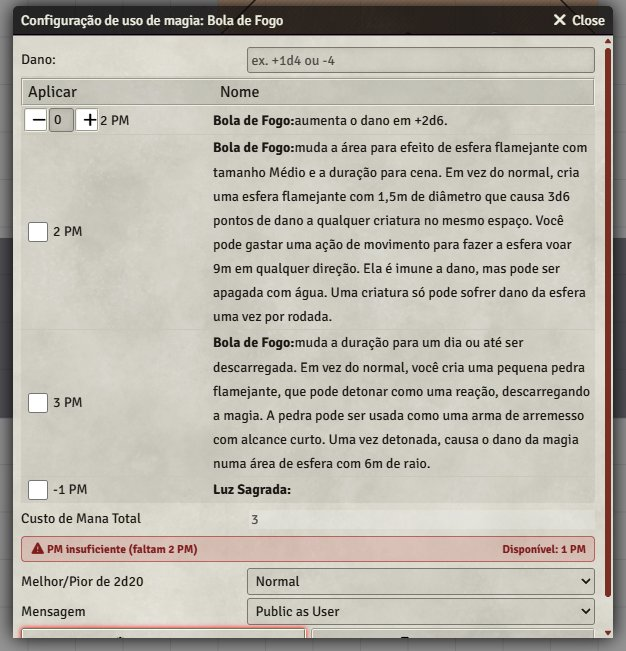
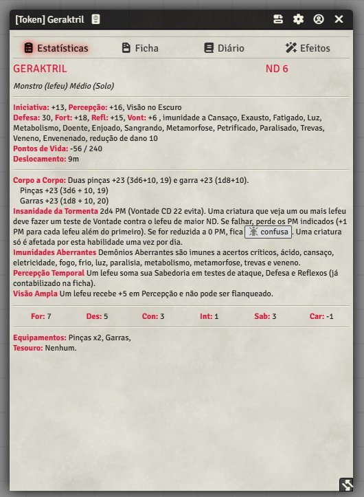

# Tormenta20 — Compêndios Completos (Estilo PF2e)

Módulo para **Foundry VTT v14** e o sistema **Tormenta20 (`tormenta20`)**, reunindo **11 compêndios organizados**, uma **ficha completa inspirada no Pathfinder 2e**, automação de **criação e subida de nível (`ABC+D`)**, **identificadores e breakdown de rolagens em PT-BR**, **HUDs flutuantes**, **visão automática de token** e um **tema unificado em Pergaminho de Arton**.

> **Compatibilidade:** Foundry VTT **v14** · Sistema **`tormenta20` 1.6.0+** (verificado em `1.6.6`) · Idioma **Português (Brasil)**

---

## Instalação

Este módulo é distribuído diretamente via **GitHub Releases** (não listado no diretório oficial do Foundry VTT).

### 1. Via URL do Manifesto (Recomendado)

1. No Foundry VTT, acesse **Módulos Complementares** (*Add-on Modules*) → **Instalar Módulo** (*Install Module*).
2. No campo **Manifest URL**, cole a URL direta do `module.json` da última Release deste repositório:
   ```text
   https://github.com/<SEU-USUARIO>/<SEU-REPOSITORIO>/releases/latest/download/module.json
   ```
3. Clique em **Instalar** e, após entrar no mundo de Tormenta20, ative **Tormenta20 — Compêndios Completos (Estilo PF2e)** em **Gerenciar Módulos**.

### 2. Instalação Manual (`.zip`)

1. Baixe o arquivo `t20-compendios-completos.zip` na página de **Releases** deste repositório.
2. Extraia o conteúdo do arquivo diretamente para a pasta:
   ```text
   <FoundryData>/Data/modules/t20-compendios-completos/
   ```
   *(Certifique-se de que `module.json` fique diretamente dentro de `t20-compendios-completos/`, sem pasta duplicada.)*
3. Reinicie o Foundry (ou recarregue os módulos) e habilite o módulo no mundo.

---

## Galeria da Interface

| Ficha de Personagem (Estilo PF2e) | Navegador de Compêndios — Arton |
| :---: | :---: |
|  |  |

| HUDs Flutuantes (Ações Rápidas & Vitais) | Cards de Rolagem com Badges e Pills (PT-BR) |
| :---: | :---: |
|  |  |

<details>
<summary>Mais capturas de tela (Modais de Uso, Inventário/Forja, Perícias de Classe e Ameaça)</summary>

| Aba Inventário & Forja | Seleção de Perícias de Classe |
| :---: | :---: |
|  |  |

| Modal de Uso de Habilidade (Tema Arton) | Modal de Uso de Magia (Cálculo de PM) |
| :---: | :---: |
|  |  |

| Ficha de Ameaça / Statblock (Estilo Pergaminho) |
| :---: |
|  |

</details>

---

## O Que Está Incluído

### 1. Compêndios Organizados (11 Packs)

Agrupados automaticamente na pasta **Tormenta20 Completo** na barra de compêndios:

- **Criação de Personagem:** `classes` (Classes — Livro Básico Completo), `racas` (Raças), `origens` (Origens), `poderes` (Poderes & Habilidades), `parceiros` (Parceiros & Montarias), `divindades` (Divindades — Panteão de Arton).
- **Magias & Equipamentos:** `magias` (Magias — Livro Básico Completo), `equipamentos` (Equipamentos & Serviços), `itens-magicos` (Itens Mágicos, Poções & Artefatos).
- **Bestiário & Guias:** `ameacas` (Ameaças — Livro Básico + Lore), `guias-basico` (Guias & Regras).

---

### 2. Ficha Estilo Pathfinder 2e + Tema Pergaminho de Arton

- **Barra lateral persistente**: PV e PM (com valores atuais, máximos e temporários), Defesa total, Salvaguardas & Sentidos (`Fortitude`, `Reflexos`, `Vontade`, `Iniciativa`, `Percepção`) e os 6 Atributos sempre acessíveis.
- **Cabeçalho `ABC+D`**: slots visuais clicáveis para **Raça**, **Origem**, **Classe** e **Divindade**, além de botão direto para o Navegador de Compêndios e barra de XP.
- **8 abas organizadas**: `Personagem`, `Combate`, `Perícias`, `Poderes`, `Magias`, `Inventário`, `Efeitos` e `Diário`.
- **Tema Unificado (`t20-arton-theme.css` + `arton-ui-theme.js`)**: paletas Pergaminho Claro (`#F4ECE0` / `#EDE3D2`), Carmesim Real (`#7A1818`), Dourado Envelhecido (`#C59B38`) e Azul Arcano (`#1D4E89`) aplicadas também às modais de rolagem (`AbilityUseDialog`), cards do chat, caixa de entrada do chat e fichas nativas/NPCs.

---

### 3. Automação de Criação e Subida de Nível

- **Fluxo guiado ao arrastar Raça, Origem, Classe ou Divindade**: aplicação de proficiências, perícias automáticas e modais interativas para escolher perícias de classe ou benefícios de origem.
- **Espaços de Progressão por Nível (`progression-slots.js`)**:
  - Gera slots dedicados para Poderes de Classe por nível e painel de cotas de Magias por círculo conforme a classe conjuradora.
  - Importação automática de passivas de classe e cálculo de escalonamento por nível/patamar.
  - Reversão segura de itens derivados quando o nível da classe é reduzido.
- **Validação de Pré-requisitos (`power-prereq-evaluator.js`)**: verifica pré-requisitos de poderes (atributos, perícias treinadas, nível e poderes anteriores) antes da adição.

---

### 4. Navegador de Compêndios — Arton (`CompendiumBrowserT20`)

Acessível diretamente pela ficha ou pelo botão **Navegador T20 (PF2e)** na aba de Compêndios:

- Abas rápidas para **Classes**, **Raças**, **Origens**, **Divindades**, **Poderes**, **Magias**, **Equipamentos**, **Efeitos & Ações** e **Ameaças**.
- Busca instantânea, filtros combinados por fonte, tipo, subtipo/classe e propriedades.
- Pré-visualização rica na lateral direita e botão de **Adicionar** diretamente para o personagem alvo.

---

### 5. Rolagens Inteligentes, Chat Cards e Modais de Uso

- **Identificadores e Breakdown em PT-BR (`roll-metadata.js` + `chat-enhancer.js`)**:
  - Exibe faixa de características (*traits*) e pílulas individuais dos bônus que compõem a rolagem (`½ Nível`, Atributo, `Treino`, bônus/penalidades situacionais, dano/crítico) em **Ataques**, **Dano**, **Perícias**, **Atributos** e **Magias/Poderes**.
- **Modal `AbilityUseDialog` aprimorada**:
  - Badge em tempo real de custo total em PM vs. PM disponível (com destaque de insuficiência).
  - Filtro automático por nível para aprimoramentos/variações escalonáveis como **Especialista** (exibindo apenas a opção válida para o nível do personagem).
- **Gestão de Mana no Chat**: desconto automático de PM ao usar habilidades/magias e botão **Desfazer PM** direto no card.

---

### 6. HUDs de Token & Visão Automática (Foundry v14)

- **HUD de Ações Rápidas (`token-quick-actions.js`)**: barra compacta flutuante para rolar com 1 clique `Defesa`, `Iniciativa`, `Percepção`, `Fortitude`, `Reflexos`, `Vontade`, `Ataques`, `Magias` (com CD), `Habilidades` e `Outras Perícias`.
- **HUD de Vitais (`token-vitals.js`)**: botões rápidos de `+1 / +5 / +10 / -1 / -5 / -10`, aplicação de **Dano (RD)** ou **Dano Direto**, **Cura**, **PV Temporário** e controle de **PM**.
- **Visão Automática de Token (`token-vision.js`)**: detecta sentidos na ficha/poderes (`Visão no Escuro`, `Visão na Penumbra` / `Sentidos Élficos`, `Percepção às Cegas`, `Visão nas Trevas`, `Visão Mística`, `Ver o Invisível`, `Visão da Verdade`) e configura os `detectionModes` e alcance do token no Foundry v14.

---

### 7. Ferramentas de Mesa & Automação de Combate

- **Painel de Efeitos & Condições (`effects-panel.js`)**: lista flutuante no canvas com efeitos ativos do token e seletor rápido de condições do Tormenta20.
- **Solicitação de Teste (`check-prompt.js`)**: ferramenta do Mestre para enviar botões clicáveis de teste (perícia + CD opcional) para o chat dos jogadores.
- **Ficha de Grupo (`party-sheet.js`)**: resumo consolidado dos personagens do grupo com vitais, moedas/Tibares e matriz comparativa de perícias.
- **Forja de Equipamentos (`forge-modal.js`)**: aplica materiais especiais, melhorias e encantamentos oficiais em armas, armaduras, escudos e esotéricos calculando o custo em Tibares.
- **Mercador & Tesouro (`loot-merchant.js`)**: gera estoque por tipo de loja (`Empório Geral`, `Armeiro & Ferreiro`, `Boticário & Alquimista`, `Empório Arcano`) ou tesouro por ND, permitindo compras pelos jogadores via socket.
- **Escalonador de Ameaças (`npc-scaler.js`)**: ajusta rapidamente fichas de ameaças entre `Fraco (-1 ND)`, `Padrão`, `Elite (+1 ND)` e `Chefe (PV ×2)`.
- **Rastreador de Combate (`combat-enhancer.js`)**: alertas automáticos no turno para condições contínuas (`Sangrando`, `Em Chamas`, `Envenenado`, `Sustentando Efeito`, `Atordoado`, `Pasmo`, `Agarrado`, etc.).

---

## Empacotamento e Publicação (Para Mantenedores)

Com o Foundry VTT fechado (para evitar travas de LevelDB nos compêndios), execute na raiz do módulo:

```powershell
.\package-release.ps1
```

O script valida `module.json`, ignora arquivos `LOCK` de `packs/*/` e gera em `dist/`:
- `dist/t20-compendios-completos.zip` (pronto para upload na GitHub Release)
- `dist/module.json` (manifesto correspondente à versão empacotada)

Antes de gerar uma nova release pública, configure em `module.json` os campos `url`, `manifest` e `download` apontando para o seu repositório GitHub.

---

## Aviso Legal & Créditos

- **Código e automação:** licenciado sob a [Licença MIT](LICENSE).
- **Tormenta20:** todo o universo de Arton, sistema de regras, nomes de classes, raças, magias, poderes, equipamentos, divindades e ameaças são propriedade intelectual da **Jambô Editora** e dos criadores de **Tormenta20 Jogo do Ano**.
- Projeto comunitário feito de fã para fã, **sem fins lucrativos** e sem afiliação oficial com a Jambô Editora ou com a equipe oficial do sistema `tormenta20` no Foundry VTT.
